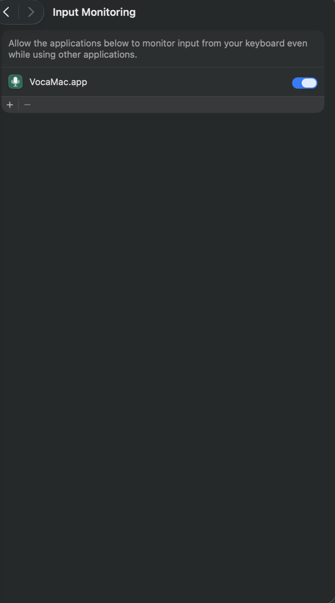
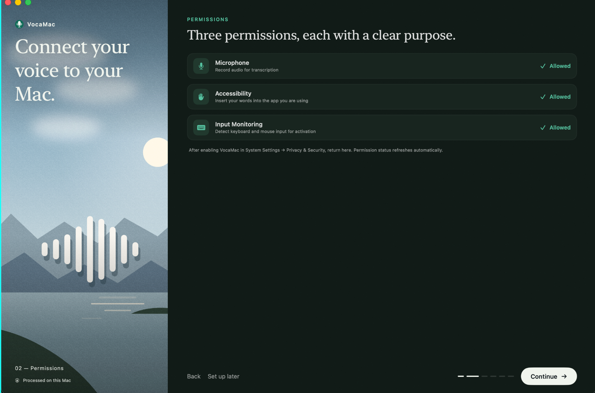
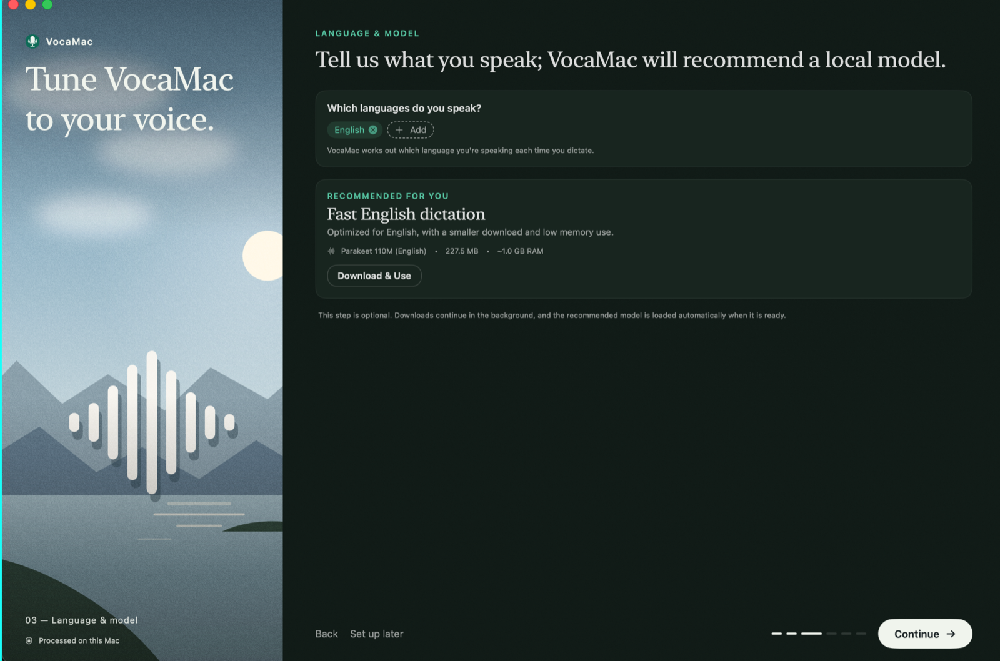
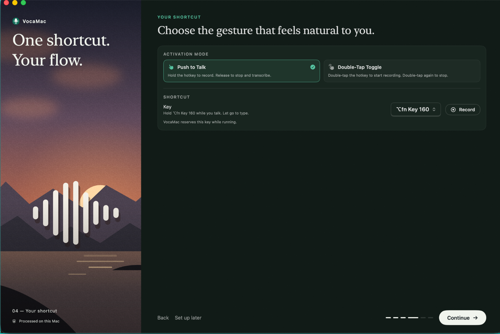
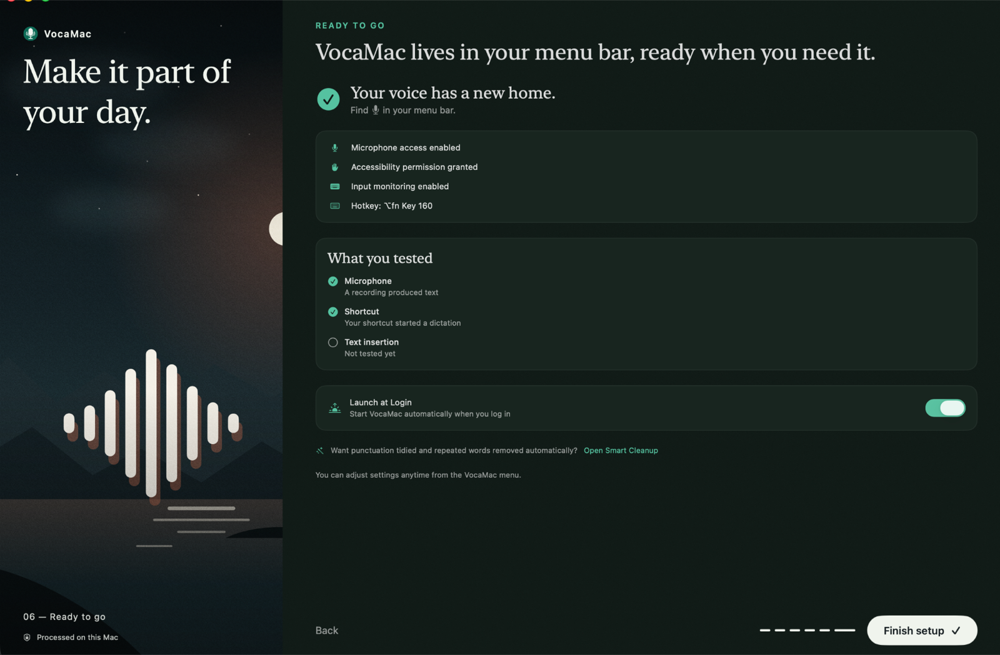
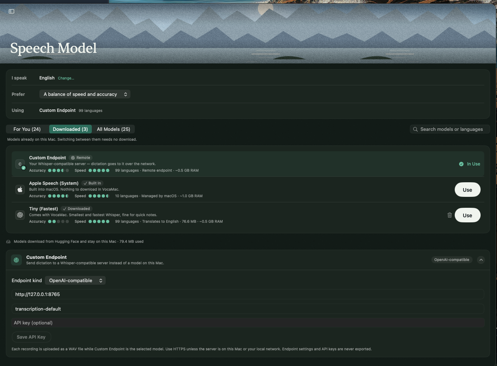

# MLX Whisper for VocaMac

A small, local OpenAI-compatible transcription service for [VocaMac](https://vocamac.com/),
using the MLX conversion of Whisper large-v3-turbo on Apple Silicon. It binds only to
`127.0.0.1`; it is not a LAN service.

The pinned model is `mlx-community/whisper-large-v3-turbo` at revision
`a4aaeec0636e6fef84abdcbe3544cb2bf7e9f6fb`. It is the same large-v3-turbo model
variant used as the first STT candidate in
[`multi-model-helper-server`](https://tea.kyle-merritt.com/anodyine/multi-model-helper-server),
but it is a separate MLX conversion rather than the CTranslate2 artifact used there.
The checkpoint is downloaded on first transcription into Hugging Face's external
cache; model weights and audio recordings do not belong in this repository.

## Requirements

- Apple Silicon Mac running macOS 14 or later (the tested target is an M5 Pro).
- Homebrew.
- Python 3.13. `uv sync` selects the project-pinned version and creates `.venv`.
- VocaMac 1.1 or later for its Custom Endpoint feature. The current Homebrew
  cask installs the signed, notarized Apple Silicon app.

## One-command developer install

From a persistent clone of this repository, run:

```sh
./scripts/install-dev.sh
```

The installer checks for Apple Silicon macOS 14+, Homebrew, and a free port
8765; installs `uv` and FFmpeg; installs VocaMac from its official Homebrew
cask if it is not already present; syncs the pinned Python environment;
installs or updates the per-user LaunchAgent; then opens VocaMac. It is safe to
repeat and does not use `sudo`, replace an existing VocaMac app, or delete
model caches or logs. If it needs to install VocaMac, it asks before trusting
the third-party `vocahq/vocamac` tap. Pass `--yes` only when explicitly
approving that trust step.

The LaunchAgent runs the checkout from which the script was run. Use a
persistent clone, not a temporary issue worktree: removing that checkout would
break future service starts. It creates or updates
`~/Library/LaunchAgents/com.anodyine.mlx-whisper-vocamac.plist` and starts the
service now and at future logins. The service listens only on
`127.0.0.1:8765`.

The script does **not** change VocaMac's endpoint preferences or grant macOS
privacy permissions. Finish those in the app and System Settings below. The
Custom Endpoint is deliberately a manual selection because VocaMac does not
provide a supported command-line setup interface.

The installer checks the port before installing the LaunchAgent. To check it
yourself:

```sh
lsof -nP -iTCP:8765 -sTCP:LISTEN
```

No output means no process is listening. If a process is listed, identify it
before proceeding; do not kill an unknown process.

The API starts on `http://127.0.0.1:8765`. Audio is held in a request-scoped
temporary file while FFmpeg/MLX reads it, and that file is removed after
processing. Audio uploads are limited to 25 MiB, with up to 64 KiB for multipart
framing and form fields. Transcripts and audio are not logged.

The first transcription loads the pinned
`mlx-community/whisper-large-v3-turbo` checkpoint. If it is not cached, the
first request downloads about 1.6 GB to `~/.cache/huggingface`, outside the
checkout. Later requests reuse that cache. The service does not warm the model
at login.

## Grant macOS permissions

On first launch, VocaMac requests permissions for microphone access, the
system-wide push-to-talk shortcut, and text insertion. Grant these in the
macOS permission prompts, or open **Apple menu → System Settings → Privacy &
Security** and enable VocaMac in each section:

| Permission | Why VocaMac needs it |
| --- | --- |
| **Microphone** | Captures the dictation recording. |
| **Input Monitoring** | Receives the global push-to-talk hotkey while another app is active. |
| **Accessibility** | Inserts the transcript at the active text cursor. |



If a permission is missing from its list, open VocaMac and try the relevant
action once to trigger macOS's permission request. After changing a permission,
quit and reopen VocaMac. Some managed Macs require an administrator or an MDM
privacy profile to grant Accessibility or Input Monitoring; do not work around
that policy by changing system security settings.

During onboarding:

- On **Permissions**, continue when Microphone, Accessibility, and Input
  Monitoring all show **Allowed**. Otherwise use the System Settings steps
  above, then return to VocaMac.

  

- On **Language & Model**, select **Set up later**. Do not select **Download &
  Use** for “Fast English dictation”: that downloads VocaMac's separate local
  Parakeet model, which this walkthrough does not use. Our service downloads
  and runs the pinned MLX Whisper model on the first Custom Endpoint request.

  

- On **Your Shortcut**, leave **Push to Talk** selected. For this developer
  walkthrough, use **Record** to set **Left Option + F3 (⌥F3)**. The owner
  tested it without a Mission Control conflict on the target Mac. On that
  keyboard VocaMac displays the recorded key as `⌥fn Key 160`; the owner
  confirmed that label corresponds to Left Option+F3. Check the shortcut on
  each Mac, and choose a different unused key if it conflicts.

  

- On **Ready to go**, turn on **Launch at Login** if VocaMac's menu-bar app and
  hotkey should be available after login. This is separate from the local
  service LaunchAgent: both must start for automatic dictation.

  

## Configure the Custom Endpoint

In VocaMac, open **Settings → Speech Model**. In the model list, locate
**Custom Endpoint** and click its **Use** button. Confirm the summary at the top
says **Using Custom Endpoint** and the row is marked **In Use**. Filling the
settings card alone does not activate the endpoint.

Expand the **Custom Endpoint** settings card, choose **OpenAI-compatible**, and
enter these exact values:

| Field | Value |
| --- | --- |
| **Base URL** | `http://127.0.0.1:8765` |
| **Model** | `transcription-default` |
| **API key** | Leave blank |



Do not add `/v1` to the base URL. VocaMac posts WAV recordings to
`/v1/audio/transcriptions`; this endpoint intentionally has no authentication
and is reachable only from this Mac. Do not change its bind address or place it
behind a network-facing proxy without adding an authentication boundary.

VocaMac uploads a recording only while **Custom Endpoint** is selected. Choose
a local speech model to return to on-device transcription.

## Check the service and model

From the same checkout, check the LaunchAgent and health endpoint:

```sh
uv run mlx-whisper-vocamac-agent status
curl -i http://127.0.0.1:8765/health
```

The job should report `state = running`. Before the first successful
transcription, health returns HTTP 503 with `{"status":"starting"}`. This is
expected: the model is loaded lazily, not at login.

For a repeatable HTTP smoke test, synthesize disposable speech outside the
checkout. The command discards the response body and removes the temporary
AIFF/WAV on exit:

```sh
set -eu
test_dir="$(mktemp -d "${TMPDIR:-/tmp}/mlx-whisper-smoke.XXXXXX")"
trap 'rm -rf "$test_dir"' EXIT
say -o "$test_dir/sample.aiff" "The local transcription service is running."
ffmpeg -hide_banner -loglevel error -y -i "$test_dir/sample.aiff" \
  -ar 16000 -ac 1 "$test_dir/sample.wav"
curl --fail --silent --show-error --output /dev/null --write-out 'HTTP %{http_code}\n' \
  http://127.0.0.1:8765/v1/audio/transcriptions \
  -F model=transcription-default -F "file=@$test_dir/sample.wav"
curl --silent --show-error http://127.0.0.1:8765/health
```

Expected: the request prints `HTTP 200` and health prints
`{"status":"ready"}`. The first request may take longer while the model is
downloaded and loaded. Do not use a private recording for this smoke test.

### Optional foreground troubleshooting

Use this two-terminal path only when diagnosing the LaunchAgent. Do not run a
foreground server while the LaunchAgent is listening on port 8765.

**Terminal A — stop the LaunchAgent and run the server in the foreground:**

```sh
uv run mlx-whisper-vocamac-agent stop
uv run mlx-whisper-vocamac
```

Expected: Uvicorn reports `http://127.0.0.1:8765` and stays in the foreground.
Keep this terminal open while testing.

**Terminal B — check health and run the HTTP smoke test:**

```sh
curl -i http://127.0.0.1:8765/health
```

Run the synthetic smoke-test command above in Terminal B. Press Control-C in
Terminal A to stop the foreground server, then restore automatic startup:

```sh
uv run mlx-whisper-vocamac-agent start
```

## Verify VocaMac dictation

Use the built-in **Push-to-Talk** mode. For this developer walkthrough, we
recommend **Left Option + F3 (⌥F3)**: the owner tested it on the target Mac and
reported that it did not trigger Mission Control. Set it with VocaMac's
**Record** shortcut control during onboarding or under **Settings → Dictation**.
Check that the displayed shortcut is the one you pressed. Test it on each Mac;
if F3 invokes Mission Control or another app shortcut, choose another unused
shortcut (Right Option ⌥ is VocaMac's default). Keep the service running while
testing.

1. Open a blank document in **TextEdit** and click in the document body.
2. Press and hold Left Option+F3 (⌥F3), say “VocaMac local endpoint test,”
   then release the key. Wait for transcription.
3. Confirm the words appear at the cursor, then run
   `curl -sS http://127.0.0.1:8765/health`; it should return
   `{"status":"ready"}`.

If dictation inserts text but health remains `starting`, VocaMac likely used
one of its local engines instead of the Custom Endpoint. Recheck that
**Custom Endpoint** is selected, then make one more short test dictation.
Additional cross-field and silence checks are part of issue #4.

Record the VocaMac version, endpoint kind, base URL, model, permission outcomes,
which text fields passed, and the silence result in issue #4. Do not include
audio, transcript text, API keys, or screenshots showing private recordings or
unrelated personal data.

## Stop, restart, or uninstall

Run these from the same checkout:

```sh
uv run mlx-whisper-vocamac-agent stop
uv run mlx-whisper-vocamac-agent start
uv run mlx-whisper-vocamac-agent restart
uv run mlx-whisper-vocamac-agent status
uv run mlx-whisper-vocamac-agent uninstall
```

`stop` unloads the job for the current login session; the plist remains, so it
will load on the next login. `uninstall` unloads the job and removes only its
plist. It preserves operational logs and model weights. Unexpected nonzero
exits are restarted by launchd with a 30-second throttle to avoid a rapid
restart loop.

Operational logs are outside the repository:

- `~/Library/Logs/mlx-whisper-vocamac/service.log`
- `~/Library/Logs/mlx-whisper-vocamac/error.log`

The LaunchAgent uses a private log directory and restrictive file umask. HTTP
access logging is disabled, and the service does not log submitted audio or
transcript text. The Hugging Face cache at `~/.cache/huggingface` is not removed
by `uninstall`.

## Troubleshooting

| Symptom | Check or recovery |
| --- | --- |
| `uv run ... install` says FFmpeg is missing | Run `brew install ffmpeg`, then retry the install. |
| Port 8765 is already in use | Identify the listener with `lsof -nP -iTCP:8765 -sTCP:LISTEN`; stop only a process you recognize. |
| `status` says the LaunchAgent is not loaded | Run `uv run mlx-whisper-vocamac-agent install`; inspect `~/Library/Logs/mlx-whisper-vocamac/error.log` if it fails. |
| `/health` reports `starting` | Expected before the first successful transcription. Send one smoke or VocaMac request; the first may download the model. |
| VocaMac cannot connect | Confirm the job is running and the Base URL is exactly `http://127.0.0.1:8765`; check the error log. |
| The hotkey does nothing | Enable **Input Monitoring** for VocaMac in **System Settings → Privacy & Security**, then quit and reopen VocaMac. |
| Audio is captured but no text appears | Enable **Accessibility** for VocaMac and put the cursor in an editable text field. |
| No audio is captured | Enable **Microphone** permission and check the selected input device in VocaMac settings. |
| API says `model_not_found` | Set the model to exactly `transcription-default`. |

For a foreground-only diagnostic, follow the two-terminal procedure in
[Optional foreground troubleshooting](#optional-foreground-troubleshooting).

## Failure, recovery, and privacy

`/health` reports `starting` until a transcription succeeds in the current
process. A failed model startup or inference returns HTTP 503 with the generic
`backend_unavailable` error and leaves health at `starting`; retry after
resolving a persistent backend problem. After one successful transcription,
health stays `ready` even if an individual later request fails. Unsupported
filename extensions and malformed multipart requests return HTTP 400. A
supported filename whose contents cannot be decoded may reach the backend and
return the same generic HTTP 503 response. Requests above the upload limit
return HTTP 413. The service rejects encoded request bodies larger than 25 MiB
plus 64 KiB before multipart parsing, including streaming requests without a
`Content-Length` header; an audio payload just over 25 MiB is rejected after
bounded multipart parsing.

Inference is serialized: concurrent dictations wait rather than using the MLX
backend in parallel. Disconnecting or canceling a client does not interrupt an
in-progress model call. The service keeps that request's temporary audio file
until the backend finishes, then removes it; a disconnected client receives no
result and can retry afterward. The HTTP access log is disabled, and backend
failures log only the exception type—not the exception message, audio, filename,
or transcript. Do not enable request-body or transcription logging in a proxy or
server added in front of this loopback-only service.

## Development

```sh
make check
```

The tests inject a fake transcriber and do not download or run model weights. A
real dictation check is still needed on the target Mac to assess latency, audio
format handling, and recognition quality with the owner's microphone and vocabulary.

## Model and code licensing

This repository's code is MIT-licensed. Model weights are not included; review the
model card and its upstream license before redistribution or other use. VocaMac is
separately licensed by its publisher.
